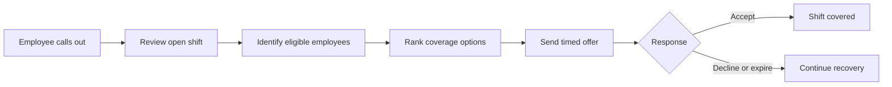

# ShiftRepair

> A JavaFX prototype for coordinating shift call-outs and recovery workflows.

ShiftRepair helps managers and employees move through the operational steps that follow an unexpected call-out. The current prototype combines manager-facing schedule and recovery views with an employee-facing timed offer experience.

## Why It Matters

When an employee calls out, managers often have to compare availability, qualifications, overtime risk, and fairness under time pressure. ShiftRepair is designed to make that process visible, consistent, and easier to track.

## Current Prototype

- Manager dashboard with scheduled and called-out shifts
- Schedule, recovery, employee, and recovery-detail views
- Employee view for incoming coverage opportunities
- Timed offers with pending, accepted, declined, and expired states
- Coverage score and human-readable selection reasons
- Light and dark themes
- Reusable JavaFX navigation shell
- Sample in-memory data for demonstration

> **Project status:** The user-interface workflow is implemented. Shared recovery logic, persistence, and production integrations are planned next steps.

## Workflow



## Technology


## Project Structure

```text
src/main/java/com/shiftrepair/
├── App.java
├── controller/
├── model/
└── theme/

src/main/resources/com/shiftrepair/
├── css/
└── fxml/
```

## Run Locally

### Requirements

- JDK 23
- Maven 3.9 or later

### Start the application

```bash
git clone https://github.com/Mohan-Lingamaneni/ShiftRepair.git
cd ShiftRepair
mvn clean javafx:run
```

## Design Direction

The interface uses a clean operations-dashboard style with clear status treatments, reusable cards, accessible labels, responsive navigation, and a focused teal/blue accent. Both light and dark themes are included.

## Roadmap

- Connect the UI to shared eligibility and scoring logic
- Add persistence for employees, schedules, and recovery events
- Implement end-to-end offer cascading
- Add automated tests for workflow and model behavior
- Add screenshots and a short product walkthrough

## Team

Built as a four-person Information Systems project. My work centers on the front-end workflow, dashboard experience, GitHub collaboration, integration support, and project coordination.

## Notes

All employee and shift information currently shown by the application is fictional demonstration data.
